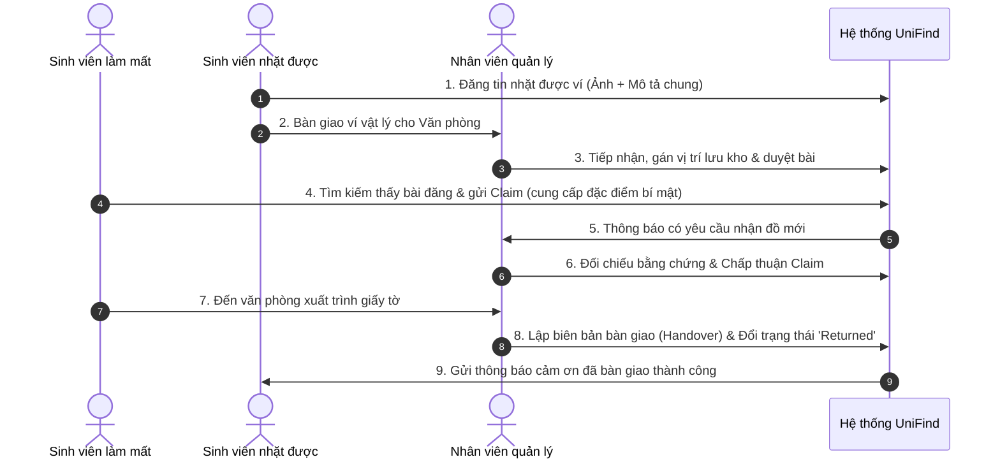

# TÀI LIỆU ĐẶC TẢ YÊU CẦU PHẦN MỀM (SRS)
## DỰ ÁN: UNIFIND – HỆ THỐNG TÌM KIẾM VÀ QUẢN LÝ ĐỒ THẤT LẠC TRONG TRƯỜNG ĐẠI HỌC

---

### 1. GIỚI THIỆU TỔNG QUAN
- **Tên dự án tiếng Việt:** Hệ thống quản lý và tìm kiếm đồ thất lạc dành cho sinh viên.
- **Tên dự án tiếng Anh:** University Lost & Found Management System (UniFind).
- **Mục tiêu:** Số hóa và tập trung hóa quy trình báo mất, nhặt được, lưu kho và bàn giao đồ thất lạc trong phạm vi khuôn viên trường đại học; ngăn chặn gian lận/nhận nhầm đồ thông qua quy trình xác minh bí mật (Private Description).

---

### 2. CÁC TÁC NHÂN HỆ THỐNG (ACTORS)
1. **Khách (Guest):** Xem danh sách đồ vật công khai, tìm kiếm cơ bản.
2. **Sinh viên / Giảng viên (User):**
   - Đăng ký, đăng nhập tài khoản.
   - Đăng tin mất đồ (Lost Item) kèm mô tả công khai và thông tin xác minh.
   - Đăng tin nhặt được đồ (Found Item) và chọn phương thức giữ đồ hoặc bàn giao phòng ban.
   - Gửi yêu cầu nhận đồ (Claim) với bằng chứng sở hữu.
   - Theo dõi trạng thái đồ và nhận thông báo realtime.
3. **Nhân viên / Cán bộ quản lý (Staff):**
   - Tiếp nhận đồ vật vật lý được giao nộp, phân bổ vị trí lưu kho.
   - Kiểm tra, đối chiếu yêu cầu nhận đồ (Claims) với đặc điểm bảo mật (Private Description).
   - Lập biên bản và xác nhận bàn giao (Handover Record).
4. **Quản trị viên (Admin):**
   - Quản trị tài khoản người dùng, phân quyền (Role-based Access Control).
   - Duyệt bài đăng vi phạm hoặc kiểm duyệt bài mới.
   - Quản lý danh mục (Categories) và vị trí (Locations) trong trường.
   - Xem dashboard thống kê, báo cáo hiệu suất trao trả.

---

### 3. QUY TRÌNH NGHIỆP VỤ CỐT LÕI (CORE BUSINESS WORKFLOWS)

---

### 4. QUY TẮC BẢO MẬT & ĐẶC ĐIỂM RIÊNG TƯ (PRIVATE DESCRIPTION)
- **Private Description Rule:** Cột `PrivateDescription` lưu các chi tiết như: số tiền chính xác, tên trong thẻ, vết trầy riêng, mật khẩu màn hình khóa hoặc sticker bên trong.
- **API Boundary:** Tuyệt đối **không** serialize trường `PrivateDescription` trên các public endpoint (`GET /api/items`). Trường này chỉ được xem bởi:
  1. Chính người tạo bài đăng.
  2. Nhân viên có thẩm quyền (`Staff` / `Admin`) khi xét duyệt yêu cầu nhận đồ (`Claim`).

---

### 5. KIẾN TRÚC PHẦN MỀM ĐỀ XUẤT
- **Frontend:** React 18 / 19 + TypeScript + Tailwind CSS (Vite build tool)
- **Backend:** ASP.NET Core 8.0 Web API (Clean Architecture / 3-Tier Layered Architecture)
- **ORM:** Entity Framework Core 8
- **Database:** Microsoft SQL Server
- **Realtime:** SignalR Core Hub
- **Authentication:** JWT (JSON Web Token) + Refresh Token

