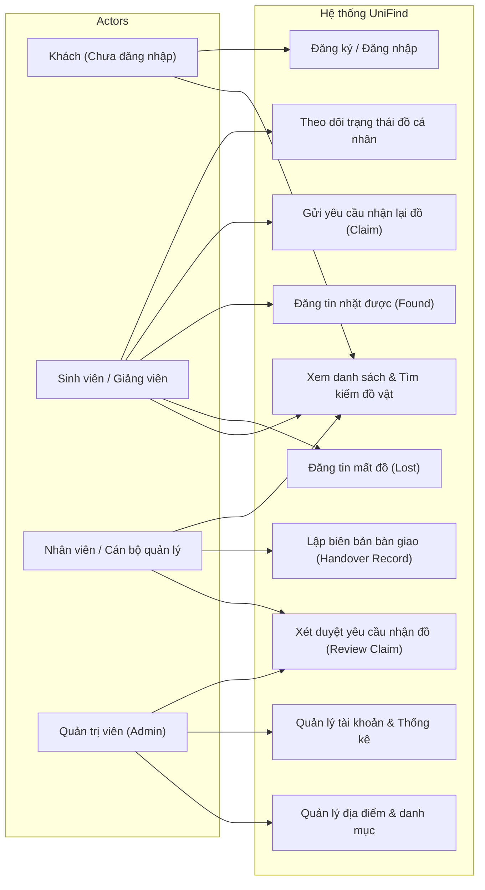
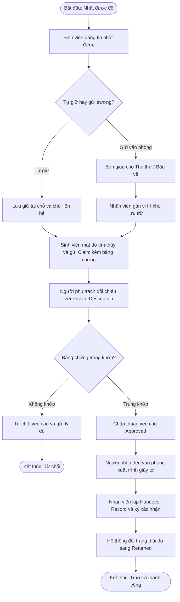
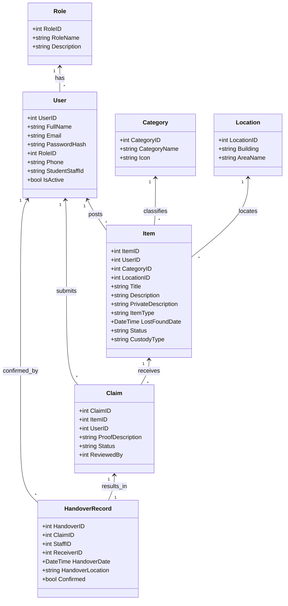

# BỘ SƠ ĐỒ THIẾT KẾ UML HỆ THỐNG UNIFIND
> Phục vụ cho Báo cáo Đồ án Chuyên ngành Công nghệ Phần mềm

---

## 1. Sơ đồ Use Case tổng quát (Use Case Diagram)

---

## 2. Sơ đồ Hoạt động: Quy trình Bàn giao Tài sản (Activity Diagram)

---

## 3. Sơ đồ Lớp thực thể (Class Diagram)

